# Plugins: theme and design kit

How a plugin's screen looks like part of Abstract. The plugin boundary itself (package,
manifest, capabilities, bridge) is in [spikes/ABS-84.md](spikes/ABS-84.md).

## Theme

A plugin draws in the theme picked in Abstract (Settings › Appearance): **Graphite**,
**Paper** or **Ink**, or whichever of them **Match System** resolves to. A named theme
holds whatever the Mac is set to, so Graphite stays dark on a Mac set to Light.

The host gives the page its colours before any of the page's own CSS loads, in a script
that runs at document start, so the first frame is already in the theme. It sets, on
`<html>`:

| What | Example |
|---|---|
| `--abstract-<role>` for every palette role (`canvas`, `surface`, `surfaceRaised`, `inset`, `hover`, `selection`, `field`, `fieldBorder`, `fieldBorderFocused`, `border`, `borderStrong`, `text`, `prose`, `textSecondary`, `textTertiary`, `accent`, `onAccent`, `added`, `removed`, `attention`, `addedWash`, `removedWash`, the `pullRequest*` colours, and more) | `--abstract-canvas: #1e1e21` |
| `--abstract-font` | the system UI font |
| `color-scheme` | `dark` or `light`, so scrollbars and form controls match |
| `background-color` | the canvas, so nothing white shows behind the page |
| `data-abstract-theme` | `graphite`, `paper` or `ink` |

When the theme changes, the same values are set again (no reload), and the plugin hears
`themeChanged` with the new `context`. The `context` message carries `theme`,
`colorScheme` and `tokens` too.

## The kit

Every plugin can use Abstract's own components. Link them from the host's scheme; the
`/_abstract/` path is reserved, and a package can't replace it:

```html
<link rel="stylesheet" href="/_abstract/abstract-ui.css">
<script src="/_abstract/abstract-ui.js"></script>
```

`abstract-ui.css` names the host's colours for components (`--ab-canvas`, `--ab-text`,
`--ab-text-2`, `--ab-text-3`, `--ab-border`, `--ab-hover`, `--ab-selection`, …) and adds
Abstract's type scale (`--ab-text-xs` 11px to `--ab-text-xl` 20px, 13px for UI), spacing
(`--ab-space-xxs` 2px to `--ab-space-xxl` 32px), radii and motion. Use those names and
no colours of your own: then your plugin is right in every theme. Motion stops when the
Mac asks for reduced motion.

`abstract-ui.js` is `window.AbstractUI`: `h(tag, props, …children)` to build elements,
`tabs({ tabs, selected, style, onSelect })` for a tab strip with arrow keys,
`empty(title, message, action)`, `skeleton(rows)`, `popover(anchor, build)`,
`flip(container, render)` to slide items to their new place after a redraw,
`isTyping(event)` and `reveal(element)`.

Each component below is drawn in Graphite, Paper and Ink.

### Page and header

`.ab-page` is a full-height column; `.ab-header` a 48px bar with a hairline below
(`.ab-header-title` for the title and a quiet count, `.ab-spacer` to push the rest right);
`.ab-toolbar` a row of filters under it; `.ab-content` the padded body;
`.ab-section-title` a small heading. The bundled plugins show these in use.

### Buttons

`.ab-button`, with `.ab-primary` (one per view), `.ab-ghost`, `.ab-danger`, `.ab-small`
and `.ab-picked`. `.ab-buttons` lays several out. `.ab-kbd` shows a key.

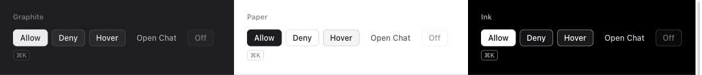

### Inputs and search

`.ab-input` for text, `.ab-field` for a label above it, and `.ab-search` wrapping an
`<input type="search">` (with an optional `.ab-kbd` hint that hides while typing).

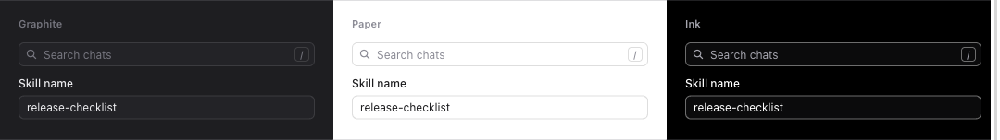

### Tabs and segmented controls

`.ab-tabs` holds `.ab-tab` buttons with `role="tab"` and `aria-selected`. Add
`.ab-segmented` for a compact switch in a header, or `.ab-underline` for a page's own
views. An `.ab-count` inside a tab shows a number. `AbstractUI.tabs()` builds either and
wires the arrow keys.

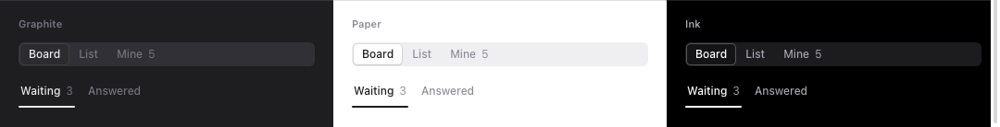

### Lists and rows

`.ab-list` of `.ab-row`: add `.ab-interactive` for a hover wash, `.ab-selected` (or
`aria-selected="true"`) for the selected one. `.ab-row-title` truncates; `.ab-row-meta`
sits quietly on the right. `.ab-group-header` is a sticky header for a group of rows.
Keyboard focus shows a ring everywhere (`:focus-visible`).

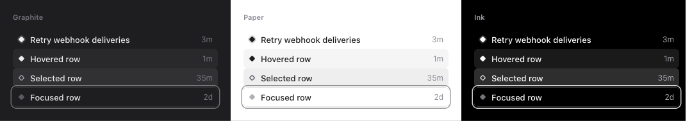

### Chips (filters)

`.ab-chip` is a dashed filter chip; `.ab-active` or `aria-pressed="true"` when it filters,
with `.ab-chip-value` for what it's set to.

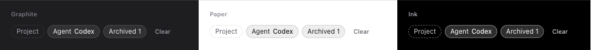

### Status and badges

`.ab-status` is the sidebar's diamond, with `.ab-needsYou`, `.ab-working` (it breathes),
`.ab-readyToReview` and `.ab-done`. `.ab-badge` is a small label: `.ab-pr-open`,
`.ab-pr-draft`, `.ab-pr-merged`, `.ab-pr-closed` for pull requests; `.ab-passed`,
`.ab-failing`, `.ab-running` for checks (with an `.ab-glyph` dot); `.ab-outline` for a
plain one.

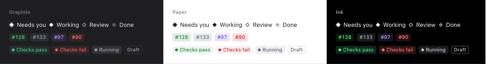

### Cards

`.ab-card`, with `.ab-interactive` and `.ab-selected` as for rows.

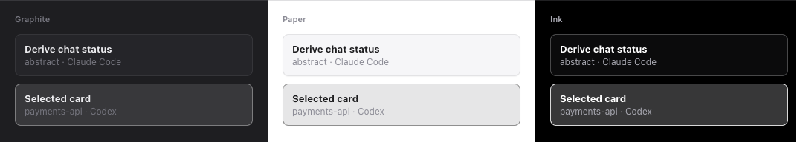

### Choices

`.ab-choice` is a radio or checkbox drawn as a card, with `.ab-choice-text` for its title
and a line below.

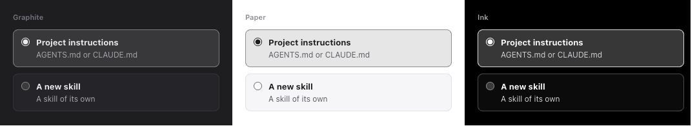

### Menus

`.ab-popover` (opened with `AbstractUI.popover()`) holds `.ab-menu-item`s; a
`role="menuitemcheckbox"` item with an `.ab-check` shows a tick when `aria-checked="true"`.

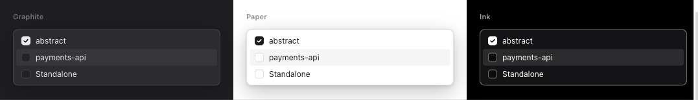

### Notices

`.ab-notice`, and `.ab-error` for something that went wrong.

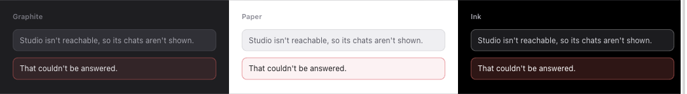

### Empty states

`AbstractUI.empty(title, message)`: say what will appear here, and how.

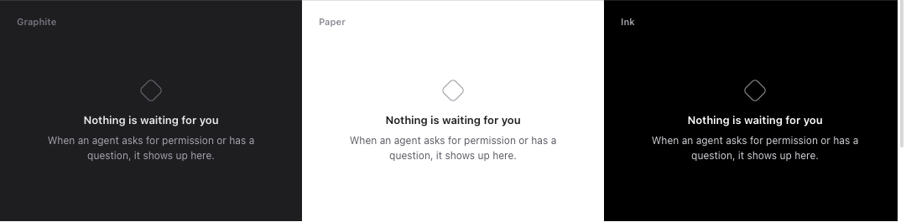

### Loading

`AbstractUI.skeleton(rows)` until the first snapshot or reply arrives.

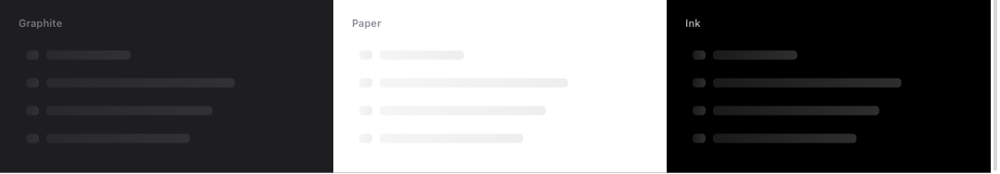

## The bundled plugins

Each in Graphite, Paper and Ink, from the demo (`--demo --snapshot`), with the Mac set to
Light.

**Kanban** — Board, List and Mine (what needs your answer or your review), remembered.
J/K or the arrows move, H/L cross columns or groups, Enter opens, / searches, 1–3 switch tabs.

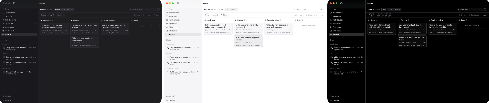
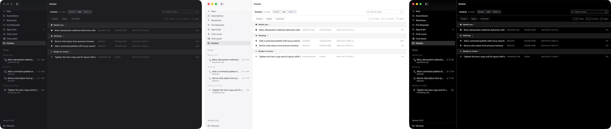
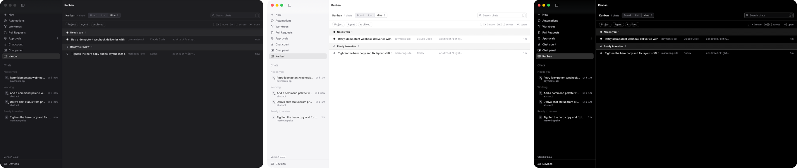

**Approvals** — Waiting and Answered.

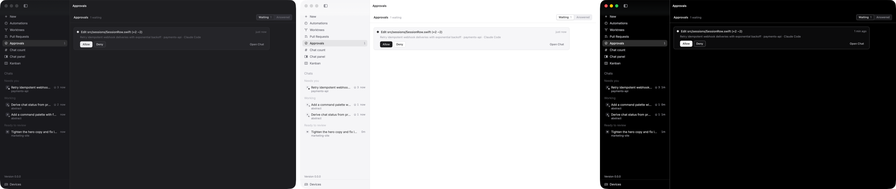

**Chat count** and **Chat panel**, the samples.

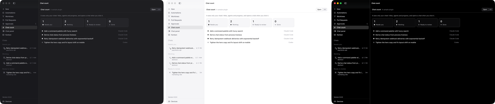
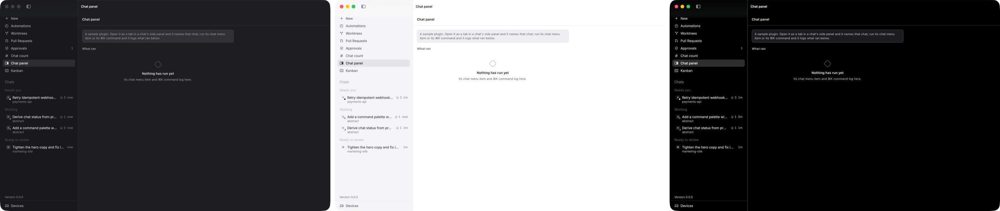

Tabs beside a chat, from the side panel's + menu: **Follow PR** (Following and History),
**Second opinion**, **Lessons** and **Chat panel**.

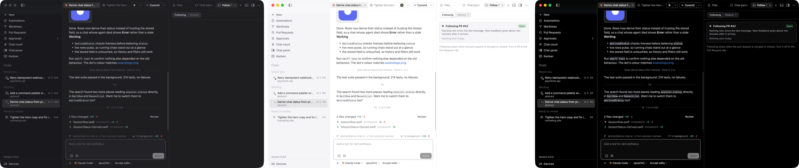
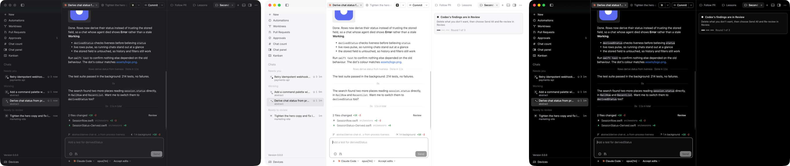
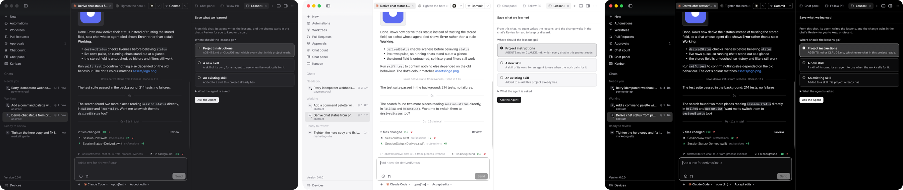
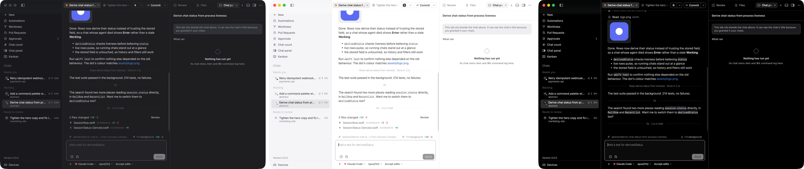

## Statuses after links

A plugin can put a short status after links in chats (ABS-126). It lists
`linkDecorators` in `contributes`, each with the links it knows as `patterns`, and
needs a background script to answer:

```json
"linkDecorators": [
  { "id": "github", "title": "GitHub", "patterns": ["https://github.com/*/*/pull/*"] }
]
```

A pattern is `https://`, an exact host, then path segments, where `*` is any one
segment. A link matches when its path starts with those segments. The script is handed
the link alone, cut to the pattern's segments, with no query or fragment, and never the
chat or the message. The review screen names the sites the patterns cover.

```js
AbstractPlugin.links.decorate("github", async (url) => ({ label: "Merged", tone: "merged" }));
```

Return `{ label, tone }` or `null` for nothing to show. The label is one line of up to
40 characters; the tone is `open`, `draft`, `merged`, `closed`, `failing` or `neutral`,
and Abstract picks the colour. A link is asked about once its message has finished
arriving and while it's on screen, and again when its status is more than four and a
half minutes old, so a change shows within five minutes. A failed lookup keeps the last
status. Clicking the status opens the link.

**Link status**, bundled, does this for GitHub pull requests (open, draft, merged or
closed, with checks) and issues, and Linear issues (state and assignee). Private
repositories need a GitHub token and Linear needs a Linear API key, entered under
Settings › Plugins.

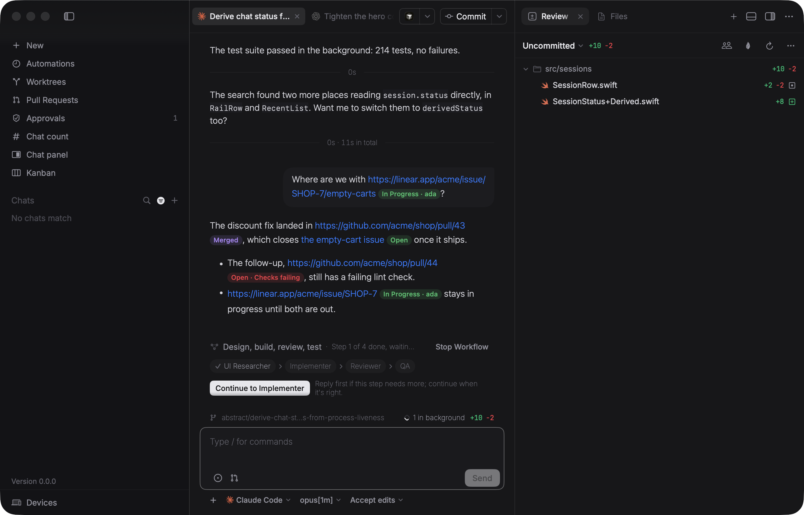

## Previewing a plugin

`python3 docs/plugin-kit/preview.py` serves the bundled plugins, the kit and a stand-in
for the host at <http://localhost:8765/>, with made-up chats. Add `?theme=paper` or
`?theme=ink`; `?place=chatPanel&chat=c6` opens a page as a tab beside a chat. The kit's
gallery is at `/__preview/gallery.html`; the screenshots above are of it.
`docs/plugin-kit/tokens.js` holds the host's colours for each theme, and the core tests
check it against the palette.
